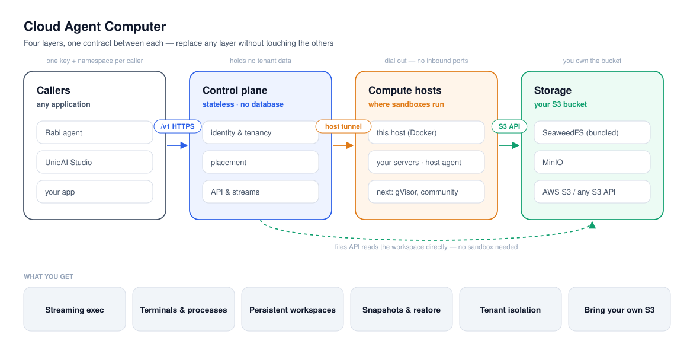
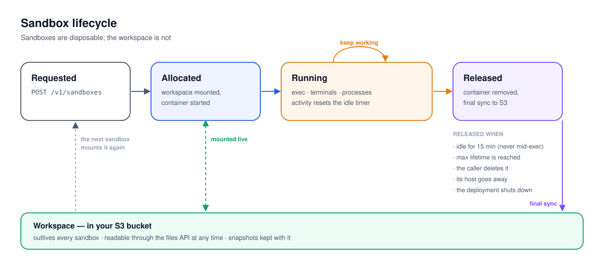
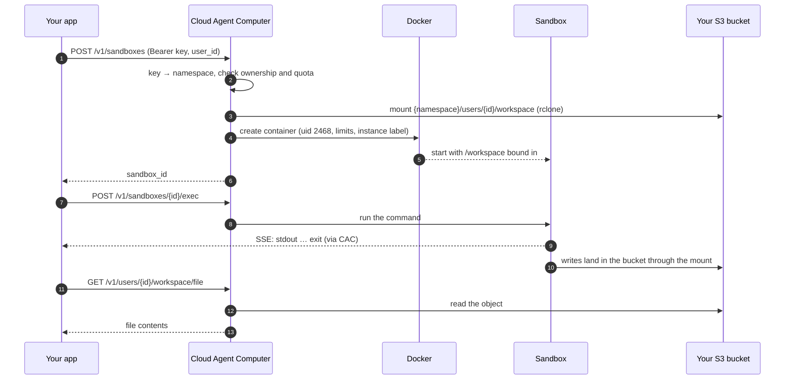

# UnieAI Cloud Agent Computer

**Isolated computers for AI agents, as a service.** Give every user, session or
tenant a Linux sandbox with a persistent workspace, and drive it over one HTTP
API: run commands and stream their output, open terminals, keep processes
running, read and write files, take snapshots.

Cloud Agent Computer (CAC) is the sandbox layer behind
[Rabi](https://agent.unieai.com) and UnieAI Studio. It is a single stateless
service: sandboxes are Docker containers, workspaces live in an S3 bucket you
own, and there is no database to run.

<picture>
  <source media="(prefers-color-scheme: dark)" srcset="docs/images/architecture-dark.svg">
  
</picture>

## Features

- **Exec with streaming** — run a command, follow stdout/stderr and the exit code
  over Server-Sent Events, cancel it.
- **Terminals** — real PTYs with input, resize and signals, for an in-browser shell.
- **Long-running processes** — start, attach, write to stdin, stop; plus a slot for
  a coding agent that runs inside the sandbox.
- **Persistent workspaces** — `/workspace` is the caller's S3 prefix, mounted live:
  what the agent writes, your file API reads at once, and the other way round.
- **Files API** — read, write, conditional write, list, batch, upload, folders and
  quotas, directly on the workspace, with or without a running sandbox.
- **Snapshots** — snapshot the workspace, diff it, restore one file or the tree.
- **Multi-tenant by construction** — every caller has its own key and namespace;
  two callers' users never meet even when their ids collide; ownership is
  enforced on every route.
- **Bring your own storage** — any S3-compatible store. A storage doctor checks it
  before the service starts and names the exact setting that is wrong.

## Quick start (single host)

Requirements: Linux with Docker Engine and Compose v2, `/dev/fuse`, and a shared
root mount (the systemd default). Plan on about 2 GB of RAM per active sandbox.

```bash
git clone https://github.com/UnieAI/UnieAI-Cloud-Agent-Computer.git
cd UnieAI-Cloud-Agent-Computer

# 1. Build the service and a generic sandbox image (or bring your own template).
docker build -f docker/sandbox-runtime/Dockerfile  -t cac/runtime:local .
docker build -f docker/sandbox-template/Dockerfile -t cac-sandbox:local .

# 2. Configure the object store and one caller key.
cd deploy/compose && cp .env.example .env
KEY=$(openssl rand -hex 32)           # hand this to your application
printf %s "$KEY" | sha256sum          # put this hash in CAC_CALLERS
$EDITOR .env

# 3. Start, with the bundled SeaweedFS …
docker compose --profile bundled-s3 up -d
#    … or against your own S3 (S3_ENDPOINT / S3_BUCKET / keys in .env)
docker compose up -d

curl -fsS http://127.0.0.1:4020/healthz
```

CAC refuses to start on a store it cannot use, and says why. Run the same check
by hand at any time:

```bash
docker compose run --rm cac node apps/sandbox-runtime/src/doctor/storage-doctor.mjs
```

### Your first sandbox

```bash
BASE=http://127.0.0.1:4020
H=(-H "authorization: Bearer $KEY" -H "x-sandbox-user-id: alice" -H "content-type: application/json")

# allocate a sandbox on alice's workspace
SBX=$(curl -fsS "${H[@]}" -X POST $BASE/v1/sandboxes \
  -d '{"user_id":"alice","session_id":"demo","workspace_mode":"user"}' | jq -r .sandbox_id)

# run a command and follow it
EXEC=$(curl -fsS "${H[@]}" -X POST $BASE/v1/sandboxes/$SBX/exec \
  -d '{"kind":"bash","payload":{"command":"echo hello > /workspace/hi.txt && uname -a"},"timeout_ms":60000}' | jq -r .exec_id)
curl -fsSN "${H[@]}" $BASE/v1/sandboxes/$SBX/exec/$EXEC/stream
# data: {"type":"stdout",...}  …  data: {"type":"exit","exit_code":0}

# the file is already in the workspace
curl -fsS "${H[@]}" "$BASE/v1/users/alice/workspace/file?path=hi.txt"

# release the sandbox (the workspace stays)
curl -fsS "${H[@]}" -X DELETE $BASE/v1/sandboxes/$SBX
```

## How it works

### Lifecycle

<picture>
  <source media="(prefers-color-scheme: dark)" srcset="docs/images/lifecycle-dark.svg">
  
</picture>

### One request, end to end

A caller asks for a sandbox, runs something in it, and reads the result from the
workspace — the sandbox never holds a storage credential.



Workspaces outlive sandboxes: releasing a sandbox removes the container, not the
files. The next sandbox for the same user mounts the same prefix.

## Configuration

Everything is an environment variable; `deploy/compose/.env.example` documents
each one. The ones you will set:

| Variable | Purpose |
| --- | --- |
| `S3_ENDPOINT` `S3_BUCKET` `S3_ACCESS_KEY` `S3_SECRET_KEY` `S3_REGION` `S3_FORCE_PATH_STYLE` | The object store. Required; there is no local-directory mode. |
| `CAC_CALLERS` | JSON list of callers, `[{"id","namespace","key_sha256"}]`. Only key hashes are stored. |
| `SANDBOX_INTERNAL_TOKEN` | Operator token (see below). Leave empty if you do not need operator routes. |
| `SANDBOX_DOCKER_IMAGE` | The template image every sandbox runs. |
| `SANDBOX_HOST_MOUNT_S3_UID` | The uid sandboxes run as, which owns `/workspace` (default `2468`). No host account may have it; never `0`. |
| `SANDBOX_DEFAULT_MEMORY_MB` `SANDBOX_DEFAULT_CPUS` | Per-sandbox limits. |
| `SANDBOX_POOL_TOTAL_MAX` | The most sandboxes this host runs at once. |
| `CAC_PORT` `CAC_MOUNT_ROOT` `CAC_STORE_SUBNET` `CAC_SANDBOX_SUBNET` | Host port, where workspace mounts live, explicit Docker subnets. |

## API

Every call carries `Authorization: Bearer <caller key>`; user-scoped calls also
send `x-sandbox-user-id`. Streams are Server-Sent Events.

| Area | Routes |
| --- | --- |
| Sandboxes | `POST /v1/sandboxes` · `GET /v1/sandboxes` · `DELETE /v1/sandboxes/{id}` · `GET /v1/sessions/{sessionId}/sandbox` · `GET /v1/users/{userId}/sandbox` |
| Exec | `POST /v1/sandboxes/{id}/exec` · `GET …/exec/{execId}/stream` · `DELETE …/exec/{execId}` |
| Terminals | `POST /v1/sandboxes/{id}/terminals` · `GET …/terminals` · `GET …/terminals/{tid}/stream` · `POST …/terminals/{tid}/{input,resize,signal}` · `DELETE …/terminals/{tid}` |
| Processes | `POST /v1/sandboxes/{id}/processes` · `GET …/processes` · `GET …/processes/{handle}/attach` · `POST …/processes/{handle}/stdin` · `DELETE …/processes/{handle}` |
| Agents | `POST /v1/sandboxes/{id}/agents` · `GET …/agents/{aid}` · `GET …/agents/{aid}/stream` · `POST …/agents/{aid}/input` · `DELETE …/agents/{aid}` |
| Sandbox files | `GET /v1/sandboxes/{id}/files` · `GET …/files/list` · `POST …/files/batch` · `POST …/upload` · `POST …/artifacts/persist` |
| Snapshots | `POST /v1/sandboxes/{id}/snapshot` · `POST …/snapshot/restore` · `POST …/snapshot/restore-file` · `GET …/snapshots` · `GET …/diff` |
| Workspace | `GET /v1/users/{userId}/workspace/{manifest,stat,file,quota}` · `POST …/workspace/file` · `POST …/workspace/file-conditional` · `DELETE …/workspace/file` · `POST`/`DELETE …/workspace/folder` · `POST …/workspace/sync` |

**Operator routes** accept only `SANDBOX_INTERNAL_TOKEN`, never a caller key:
`GET /v1/sandboxes/stream` (all tenants' events), `GET`/`POST /v1/pool/policy`,
`POST /v1/workspace-quota/limits`, `POST /v1/ssh/check`, and the machine relay
under `/v1/relay/*`. `GET /healthz` and `GET /metrics` need no token.

## Security model

- **Callers are isolated.** A caller's key maps to a namespace; its users,
  sessions and workspace owners are prefixed with it, so callers cannot address
  each other's sandboxes or files even when ids collide. Ownership is always
  enforced for namespaced callers, and they cannot set host paths or machine
  routing.
- **Sandboxes hold no secrets.** CAC mounts the workspace and binds it in; the
  sandbox never sees S3 credentials and has no network route to the store.
- **Sandboxes are unprivileged.** A dedicated non-root uid (2468), memory and CPU
  limits per sandbox, their own Docker network.
- **A deployment touches only its own sandboxes.** Every container carries this
  deployment's instance label; startup cleanup and shutdown never reach another
  deployment's sandboxes on a shared Docker host.
- **Storage is checked, not assumed.** The workspace manifest is updated with
  compare-and-swap, so a store that ignores conditional writes is refused at
  startup rather than silently losing updates.
- **Keep the port private.** `/metrics` is unauthenticated; put CAC behind your
  own network boundary or a reverse proxy.

## Operating it

- **Health:** `GET /healthz`. **Metrics:** `GET /metrics` (Prometheus text;
  currently `sandbox_active_total`).
- **Shutdown:** `docker compose down` stops CAC, which first removes its own
  sandboxes and then unmounts their workspaces (20 s grace period).
- **Logs:** structured JSON on stdout — `docker compose logs cac`.
- **Capacity:** about 2 GB of RAM per active sandbox; cap it with
  `SANDBOX_POOL_TOTAL_MAX`.

## Development

Node.js ≥ 22.15.

```bash
npm install && (cd runtime && npm install)
npm run check        # self-check and every unit test
```

The heavier checks run in throwaway containers and build nothing:

```bash
DOCKER_INTEGRATION=1 npm test                                                     # Docker round-trip
STORE=minio     scripts/s3-mount-it.sh <image with node 22 + apt> <rclone binary> # the real S3 mount
STORE=seaweedfs scripts/s3-mount-it.sh <image with node 22 + apt> <rclone binary>
scripts/bundle-smoke.sh                                                           # the whole bundle, end to end
```

A few tests are contracts with Rabi's codebase and skip with a reason when run
alone; point `COPILOT_V2_ROOT` at a Rabi checkout to include them.

### Repository layout

| Path | What |
| --- | --- |
| `runtime/apps/sandbox-runtime` | The service: HTTP API, Docker backend, pool, storage doctor |
| `runtime/packages/storage-engine` | S3 workspace storage |
| `runtime/packages/ava-local-protocol` | Relay protocol for machines that dial in |
| `runtime/packages/shared-types` | Environment loading and shared helpers |
| `docker/` | The service image and a generic sandbox template |
| `deploy/compose/` | Single-host bundle, with optional bundled SeaweedFS |
| `scripts/` | Self-check, S3 mount test, bundle smoke test |

## Roadmap

| Phase | Scope | Status |
| --- | --- | --- |
| P0 | Its own repository | Done |
| P1 | Per-caller keys and namespaces | Done |
| P2 | Single-host bundle, bring-your-own S3, storage doctor | Done |
| P3 | Host agent: machines dial in and serve sandboxes | Next |
| P4 | UnieAI Studio integration (add a machine, billing) | Planned |
| P5 | Third-party hosts, gVisor isolation | Planned |

## License

Proprietary. © UnieAI, all rights reserved.
